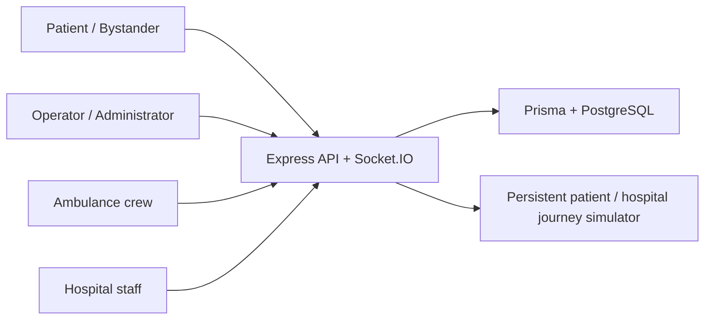

# RCRT — Rapid Cure At Right Time


## Implemented through Phase 6

- React/TypeScript/Vite/Tailwind, React Router and Leaflet/OpenStreetMap.
- Express/TypeScript, Prisma/PostgreSQL and authenticated Socket.IO.
- Patient registration, bcrypt passwords, revocable database sessions in HTTP-only cookies, role/organization authorization, and six role-specific foundations.
- Patient profile, contacts, current GPS lookup, emergency history and SOS entry point.
- Patient SOS and public anonymous bystander reports with unknown patient identity, observations, people affected and optional consented reporter contact.
- GPS accuracy/timestamps, manual map incident pins, and separate reporter GPS records. Late GPS cannot overwrite a manual pin. Written location descriptions work when maps/GPS are unavailable.
- Optional 15-second MediaRecorder audio and JPEG/PNG/WebP photos, with preview/removal and 5 MB per-file limits.
- Server-side file signatures and FFprobe audio duration/stream validation. Evidence is stored in PostgreSQL and served only to the patient owner, operators or administrators.
- Transactional case/location/attachment/audit/history creation, unique references and idempotent concurrent retries.
- Operator-only creation alerts, pending reports, protected details/evidence, and reconnect synchronization.
- Limited tracking via a 256-bit capability, hashed in the database, expiring after 72 hours. URL fragments keep the token out of request URLs. Before acceptance it exposes only reference, category, times, status and timeline; after acceptance it also shows the assigned vehicle’s latest position and reported incident point, with no location history or private case details.

**Phase 3 adds:** operator statistics, paginated case search, filters and priorities; review, notes and duplicate flags; proximity-ranked available ambulances; transactional dispatch requests; crew acceptance/decline/reassignment; GPS watch sharing; backend-driven simulation; live private/public tracking and crew-confirmed arrival.

**Phase 4 adds:** protected persistent medical assessment drafts/completion/edits, optional vital signs, essential/preferred equipment, specialist availability, explainable hospital matching, hospital maps/filters and a persisted preferred hospital.

**Phase 5 adds:** hospital-scoped admission queues and immutable request-time clinical snapshots; persistent acknowledgement and optional audible alerts; explicit acceptance/rejection; transactional reservations; cancellation before transport; preparation tasks; persistent hospital transport simulation and GPS; arrival; authorized handover receipts; case completion and ambulance release.

**Phase 6 adds:** a complete public explanation and authenticated demo guide; separate judge workspace preparation; live readiness counts scoped to the signed-in role; shared Socket.IO connections and coalesced reads; paginated admission history with independent pending alerts; consistent focus/touch/status styling; keyboard-accessible confirmation dialogs; lazy pages/maps/sign-in; safer errors/session revocation; six-width Edge/Chrome verification. No confirmation is automated and no authorization is bypassed.

**Not implemented:** real emergency dispatch, external family messages, automated clinical decisions, road routing, discharge management, advanced analytics or Phase 7 deployment. New SOS cases remain at **SOS_RECEIVED** until coordinated. A dispatch request requires crew acceptance; a hospital preference requires a separate admission request and explicit hospital acceptance.

## Architecture

Six role interfaces use the same Express API, authenticated Socket.IO server and Prisma/PostgreSQL database. Patient sessions are private cookies; anonymous bystanders retain a limited expiring tracking capability. Critical dispatch, admission, reservation and handover changes are transactional. Socket messages carry references for authorized refetches, never medical payloads.



## Requirements

Node.js 22.12+ and npm; PostgreSQL via an existing server, Docker, or the workspace-local runtime below. Tested on Windows with Node 24. Internet is needed for installation and map tiles. GPS/microphone require localhost or HTTPS. Text-only location remains available when GPS/maps fail.

## Start without Docker

In the repository root:

```powershell
npm install
npm run db:local
```

Keep that terminal open. On first use, this creates an ignored `.env` containing randomly generated database/demo passwords. It runs real PostgreSQL on `127.0.0.1:55432`, retaining data under `.local/postgres`, without installing a system service. An existing `.env` is preserved and its localhost credentials/port are used. Do not start this command on a port already used by another database.

In a second terminal:

```powershell
npm run db:generate
npm run db:migrate
npm run db:seed
npm run dev
```

Open [http://localhost:5173](http://localhost:5173). Health: [http://localhost:4000/api/health](http://localhost:4000/api/health). Stop the application and database with Ctrl+C in their terminals; restarting retains data.

If PowerShell blocks `npm.ps1`, use `npm.cmd` for each command. Stop the application before running `db:generate` on Windows: a running backend can lock Prisma's engine DLL. Keep PostgreSQL running for migration and database checks.

The optional local runtime packages PostgreSQL 18, while Compose uses PostgreSQL 17. Both use the same Prisma schema/migrations. The runtime wrapper is pinned to a beta release and intended for development. Use a managed PostgreSQL installation for deployment.

## Docker or existing PostgreSQL

If `.env` does not exist:

```powershell
Copy-Item .env.example .env
```

Set `DATABASE_URL` and `TEST_DATABASE_URL` to the intended server and choose a unique `DEMO_PASSWORD` of 12–128 characters. With the supplied Compose service, use the example URLs, start Docker Desktop, then:

```powershell
docker compose up -d --wait
npm run db:generate
npm run db:migrate
npm run db:seed
npm run dev
```

Migrations extend records without resetting Phase 1 data. Compose credentials are development defaults. Never commit environment files or real patient records.

Vite proxies `/api` and `/socket.io` to Express on port 4000 and fails clearly if port 5173 is occupied. Development trusts the configured loopback origin and its localhost/127.0.0.1/IPv6 aliases on the same port. Update `CLIENT_ORIGIN` and restart Express if the frontend port changes. Production trusts only the configured origin; cookies require HTTPS and `NODE_ENV=production`.

## Local demo accounts

Passwords come from `DEMO_PASSWORD` in your local `.env`. They are not exposed in the UI/API or printed by seeding.

| Role | Email |
| --- | --- |
| Patient | patient@rcrt.demo |
| Bystander | bystander@rcrt.demo |
| Operator | operator@rcrt.demo |
| Ambulance | ambulance@rcrt.demo |
| Hospital | hospital@rcrt.demo |
| Administrator | admin@rcrt.demo |

Also seeded: patient2, patient3, operator2, ambulance1, ambulance2, hospital1 through hospital4 (all @rcrt.demo). Five fictional hospitals, three ambulances, three patients and two operators. Seeding updates demo passwords but preserves cases/resources. Public registration creates PATIENT accounts only. Seeding is disabled in production.

## Test the workflows

Use **separate browser profiles or private windows** for different roles. Tabs in one profile share cookies.

1. **Operator:** sign in as operator@rcrt.demo, open My workspace, and confirm “Live operator alerts.” Leave it open.
2. **Patient SOS:** in another profile, sign in as patient@rcrt.demo. Open My workspace and press SOS. Choose a concern, grant GPS or select an incident pin, or describe the location. Optionally record audio and select a photo. Send the alert. Check the case reference, SOS RECEIVED timeline and tracking after refresh.
3. **Bystander SOS:** without signing in, choose **REPORT EMERGENCY FOR SOMEONE ELSE** on the homepage. Select observations (Not Sure is valid), category, affected count and location. Leave identity/contact blank for anonymity. Submit and retain the private tracking link.
4. **Operator alerts:** each report should appear immediately. Open details for separate incident/reporter coordinates, observations, consented contact and evidence. Dispatch coordination is described below.
5. **Privacy:** public tracking must not show identity, observations, evidence or location history. Only the active assigned vehicle and reported incident point are shown after acceptance. Anonymous protected case/attachment requests fail. Other patients and unassigned ambulance/hospital staff cannot access case evidence. The pending/accepted crew can view only its assigned cases; decline revokes that access.
6. **Permission denial:** deny GPS/microphone and submit using a written location and text. Evidence is optional. If evidence is rejected, remove it and resend without it.

Tracking expires after 72 hours. Keep links private. Dashboards and tracking refetch from the database after authorized Socket.IO events and on reconnect; a 15-second poll recovers missed events. Browser offline events immediately disconnect the live connection and show recovery state. Voice recording requests microphone permission only after user interaction.

## Phase 3 dispatch and journey demonstration

Use separate browser profiles (cookies are shared between tabs in the same profile):

1. Open operator@rcrt.demo in one profile and ambulance@rcrt.demo in another. Open each workspace. For a second crew, ambulance1@rcrt.demo controls DEMO-AMB-102; ambulance2 controls DEMO-AMB-103.
2. Submit a Patient or public Bystander SOS in a third profile. Retain the tracking page. Use an incident pin/GPS for the simulator; text-only reports still work but cannot provide a fabricated route.
3. In the operator workspace, open the incoming case. Set a priority and **Mark Under Review**. Add notes or flag a possible duplicate if appropriate; flags do not discard or merge a report.
4. Choose **FIND AVAILABLE AMBULANCES**, select a vehicle and confirm **REQUEST DISPATCH**. Cards use Haversine straight-line distance; ETA assumes 30 km/h and is explicitly simulated, never a driving estimate.
5. The correct crew receives a pending assignment without refresh. Choose **ACCEPT ASSIGNMENT**, or enter a reason and decline. Decline releases the vehicle and lets the operator choose another. Only acceptance confirms dispatch on all tracking views.
6. Choose **START SIMULATED JOURNEY**. The backend advances the vehicle about every second over a direct demonstration connection (roughly 13 ticks for a complete demo journey, independent of the displayed approximate ETA). Pause, resume, stop and reset all persist in PostgreSQL. Stopped simulations retain progress for resume; reset restores the saved starting point. A restarted backend resumes simulations still marked RUNNING.
7. Alternatively, enable GPS sharing. It uses watchPosition and the same backend location service. Disable sharing explicitly; it also stops when leaving the crew workspace or confirming arrival. Stop/pause simulation before switching to real GPS. Permission denial or signal loss stops sharing and leaves simulation available.
8. Watch the latest ambulance position update in the operator and reporter views without refreshing. Refresh or briefly disconnect/reconnect a browser: state reloads from PostgreSQL. Anonymous tracking never reveals crew contacts, private records, evidence or historical positions.
9. Click **MARK PATIENT REACHED** and confirm. Arrival time/history persist; GPS and simulation stop. The vehicle remains **BUSY** and assigned; assessment and hospital discovery are available next. Reaching the end of a simulated line alone never confirms arrival.

### Database and operational notes

The additive `202610240002_dispatch_tracking` migration adds vehicle/crew metadata, availability, latest-location metadata, assignment decision/journey/simulation fields, operator priority/duplicate flags and notes. Partial unique PostgreSQL indexes enforce one active assignment per case and vehicle, including pending, accepted and patient-reached assignments. Row locks protect concurrent decisions. Historical declined/completed assignments are retained. Existing demo vehicle metadata is filled only where absent; seed upserts do not reset fleet positions or assignments.

This phase ends at PATIENT_REACHED. Assessment and hospital selection now continue below. Admission, handover and releasing the vehicle belong to Phase 5 and later. Automated browser fixtures cancel only their own test assignments and release their vehicles after assertions so repeated tests do not exhaust the fleet; they do not reset user-created cases.

## Phase 4 assessment and hospital discovery

After upgrading, run `npm run db:migrate` and `npm run db:seed` before starting the application. The seed adds missing fictional resources and specialist records and preserves existing availability, quantities and fleet assignments.

1. Complete the dispatch journey above and confirm **MARK PATIENT REACHED**. In the crew workspace choose **START PATIENT ASSESSMENT**.
2. Record patient information if known. Unknown bystander patients do not need a name or identity. Enter observations manually; these are not automatic diagnoses. All vital signs are optional and remain null/blank when unavailable.
3. Select symptoms/injuries, equipment marked **Essential** or **Preferred**, and required specialists. Describe Other requirements; the engine cannot claim that unmodeled equipment or a specialist is available.
4. **Save Draft** persists observations across refresh. Reopen the assessment after refreshing. **Complete Assessment** enables matching. **Update Assessment** saves edits; version checks reject concurrent stale writes. Reload before replacing another session’s newer observations.
5. Select **Find Suitable Hospitals**. Matching uses the ambulance’s last recorded valid position, labeled GPS or simulated with its timestamp. If unavailable or stale, use **Select known search location** and click a known position. The map centre is not automatically submitted, and manual search positions do not overwrite GPS.
6. Read each fictional hospital’s matched/missing essentials and preferences, resource quantities, specialist status, ED status and explanation. Filter by distance, beds, equipment, specialty or category; default sorting prioritizes suitability before distance. Explicit distance sorting does not change suitability labels or permit incompatible selections.
7. Choose **SELECT HOSPITAL** and confirm. The crew and operator see **Hospital Selected — Admission Not Yet Confirmed**. Refresh preserves the preference. Choose a different eligible hospital before admission if needed.
8. Saving a changed assessment clears the preference and returns the case to assessment/draft status for fresh matching. Selection rechecks the current assessment version and resource availability.

### Matching policy

- Every simulated admission requires at least one emergency bed. Selected essential equipment and all required specialists must be available.
- Closed/inactive facilities are **UNAVAILABLE**. Missing essentials or unconfirmed required specialists produce **REQUIREMENTS_NOT_MET**.
- Essential-compatible facilities with missing preferences or a LIMITED emergency department are **LIMITED_RESOURCES**; otherwise they are **POTENTIAL_MATCH**.
- AVAILABLE specialists qualify; ON_CALL, UNKNOWN and UNAVAILABLE do not count as confirmed availability. Other requirements remain manual coordination items.
- Sorting uses category, unmet requirement counts, Haversine straight-line distance, then a stable ID tie-break. It reuses the Phase 3 distance utility. ETA is simulated at 30 km/h, never a driving estimate.
- Results are snapshots of fictional data, not acceptance decisions. Selection does not create an admission request, reserve/decrement resources or set an acceptance timestamp.

Only the assigned arrived crew may create/edit assessments or choose hospitals. Operators can read detailed assessments; patients, anonymous trackers, administrators and hospital users cannot read them in Phase 4. Medical events target only operators and the assigned vehicle. General case tracking never returns assessments or clinical notes.

The additive `202610240003_assessment_matching` migration extends existing assessment/hospital tables, adds specialist availability and preferred-hospital fields, and adds HOSPITAL_SELECTED. Existing rows and legacy columns are retained. One assessment per assignment and optimistic versions protect edits. The backend build excludes test-only imports; the check command still type-checks tests.

## Phase 5 manual demonstration

Use separate browser profiles or private windows for Patient, Operator, Ambulance and Hospital. Tabs in one profile share the login cookie. Passwords are the local `DEMO_PASSWORD` value. Existing installations have already received the additive migration; restart `npm.cmd run dev` after updating the code. Keep `npm.cmd run db:local` running in its own terminal.

| Hospital account | Fictional hospital |
| --- | --- |
| hospital@rcrt.demo | Pinecrest Demonstration Hospital |
| hospital1@rcrt.demo | Doon Valley Simulation Centre |
| hospital2@rcrt.demo | Silver Oak Demo Hospital |
| hospital3@rcrt.demo | Himalayan Fictional Care |
| hospital4@rcrt.demo | Riverbend Training Hospital |

1. **Admission:** run the existing SOS → operator dispatch → crew acceptance → patient arrival → completed assessment workflow. Choose equipment priorities/specialists and select a compatible hospital. Crew clicks **REQUEST HOSPITAL ADMISSION**, then confirms. The request saves the completed assessment version and snapshot. It does not reserve capacity.
2. **Alert and alarm:** sign in to the receiving hospital workspace. A red incoming-patient alert appears without refresh. Open **VIEW DETAILS**. Visual alerts work with sound disabled. Click **ENABLE EMERGENCY SOUND** to authorize Web Audio; adjust volume or use **Mute alerts**. Each unseen request produces one short, non-overlapping tone. **ACKNOWLEDGE ALERT** persists and silences it. Refresh/reconnect: the pending queue remains and acknowledged alerts do not ring again. Audio may be suspended in background tabs.
3. **Acceptance:** inspect the snapshot and free resources. Click **ACCEPT ADMISSION REQUEST**, then confirm. Acceptance rechecks the current hospital, specialists and resources. It reserves one unit of every essential quantifiable requirement, one emergency bed, and available preferred equipment. Missing preferred equipment is not falsely reserved. Specialists are capabilities, not inventory counters. The crew and operator see acceptance automatically.
4. **Rejection/reselection:** alternatively enter a rejection reason and reject. The crew sees the persisted reason and keeps its assignment. Reopen hospital discovery, refresh recommendations, select another provider, and submit a new request. The old rejected request remains in history. Sign in with that provider's account to review the new request.
5. **Reservations/cancellation:** free availability decreases only after acceptance. Before transport, crew or receiving hospital can cancel with a reason; active reservations are released exactly once. Cancellation reopens hospital discovery. Disconnecting a browser never releases resources. Cancellation after transport starts is blocked.
6. **Preparation:** after acceptance, receiving staff update applicable checklist items to Pending, In Progress or Completed. Actual completed tasks determine the percentage. Crew/operator can monitor it but cannot edit hospital tasks.
7. **Transport/tracking:** crew confirms **START TRANSPORT TO HOSPITAL**. Use **START HOSPITAL SIMULATION**, pause/resume/stop/reset, or explicitly enable hospital GPS sharing. Simulation persists on the backend, including across browser refresh and server restart. Map markers show the ambulance and hospital; distances are straight-line and ETAs simulated. Hospital, operator and permitted patient/token views update automatically. An unavailable GPS fix is never replaced with invented live data.
8. **Hospital arrival:** crew clicks **MARK ARRIVED AT HOSPITAL**, then confirms. The simulation and GPS watch stop. Hospital staff see arrival, but the ambulance remains BUSY.
9. **Handover:** receiving hospital enters staff identification and optional notes, then confirms **CONFIRM PATIENT HANDOVER** in its confirmation panel. The backend atomically records the receipt, consumes reservations, completes the assignment, resolves the emergency and makes the ambulance AVAILABLE. Occupied beds/equipment do not become free again.
10. **Receipt/reconnection:** hospital, operator and original crew can select the historical admission and inspect its private handover receipt. Public tracking shows completion without staff, clinical notes or reservation details. Hospital queues, acknowledgements and preparation survive refresh, reconnect and server restart.

For the **last ICU bed conflict** scenario, two arrived crews can request the same hospital when exactly one ICU is free (for example after a previous demo handover consumes one of its two initial ICU beds). Accept both requests from two hospital sessions. Exactly one can succeed; the other reports missing essential capacity and stays pending. The isolated integration suite creates this exact scenario automatically without changing development inventory.

Resource accounting is **free-capacity decrement on acceptance**. Reservations are ACTIVE, RELEASED on authorized cancellation, or CONSUMED on handover. There is no discharge/replenishment UI, resource editing endpoint, automatic expiry policy, automatic acceptance or automatic handover. These limits prevent accidental release of occupied resources. Hospital resource editing is deliberately read-only in this phase. The admission queue shows the latest 100 requests; backend statistics include the complete authorized scope.

## Phase 6 judge demonstration

The standard app remains at [http://localhost:5173](http://localhost:5173). Open **Explore RCRT Demo** or **Demo guide** for role instructions, scenarios and authenticated readiness. The public guide contains no passwords and grants no role access.

For a reproducible workspace separate from existing development data, keep PostgreSQL running and use:

```powershell
npm.cmd run demo:prepare
npm.cmd run demo
```

Open [http://localhost:5180/demo](http://localhost:5180/demo). This uses separate app ports 4200/5180 and a randomly named isolated PostgreSQL database. Preparation copies the same fictional hospital/fleet catalog into that new database. It never clears or reseeds the main development database. The ignored `.local/demo.env` records its configuration and the DEMO_PASSWORD copied at preparation time. Use that local password for the isolated accounts; do not publish the file.

Running `demo:prepare` again preserves the prepared workspace and resource edits. Ctrl+C stops the demo app and preserves its data. There is no global reset feature. To create a separate fresh workspace, stop the isolated app, archive `.local/demo.env` under another private filename in `.local`, and run preparation again. The previous database remains untouched; do not delete or reset unrelated databases. The database account needs CREATE DATABASE permission locally. This setup is disabled when NODE_ENV=production.

- **A — Success:** follow the Phase 5 guide above through explicit hospital handover. The vehicle is released; consumed capacity remains occupied.
- **B — Rejection:** first hospital rejects with a reason; choose another provider and submit a new request. Keep both requests in history.
- **C — Last ICU:** complete one case requiring ICU at a hospital with two initially free ICU beds. Two other cases/crews then compete for its remaining bed. Concurrent acceptance allows one reservation. The integration suite automates this safely in isolated fixtures.
- **D — Reconnect:** take the hospital browser offline and back online. Requests and acknowledgements recover; no new persistent request is invented. Sound-disabled or denied browsers retain visible emergency alerts.

The readiness panel shows backend/database checks, socket connection, selected scenario, and counts permitted by the current role. Scenario selection is a local guide choice; it does not create or automatically complete cases. Staff still perform every dispatch, acceptance, arrival and handover action.

## Environment configuration

| Variable | Purpose |
| --- | --- |
| DATABASE_URL | Main Prisma PostgreSQL connection; keep private |
| TEST_DATABASE_URL | Separate local test database ending in `_test`; never the main database |
| DEMO_PASSWORD | Local fictional accounts, 12–128 characters; never public |
| PORT | Backend port, normally 4000 |
| CLIENT_ORIGIN | Exact frontend origin; local default http://localhost:5173 |
| NODE_ENV | development locally; production only with the deployment checklist |
| RCRT_API_TARGET | Optional local frontend proxy override used by isolated runners |
| RCRT_ISOLATED_DEMO | Set by the isolated local launcher; not a login bypass or public control |

Use generated local demonstration passwords rather than real/reused credentials. The legacy login contract allows 12–128 characters, but bcrypt considers only the first 72 UTF-8 bytes. Keep local demo passwords within that byte limit; a production hashing/migration policy is an explicit deployment blocker in the readiness checklist. Existing account hashes were preserved.

## Automated checks

```powershell
npm run check
npm run lint
npm test
npm run build
npm run test:integration
npm run test:e2e
```

Use `npm.cmd` in PowerShell if script execution is disabled. The standard browser suite uses installed Microsoft Edge. To repeat it in installed Google Chrome:

```powershell
$env:RCRT_BROWSER_CHANNEL='chrome'
npm.cmd run test:e2e
Remove-Item Env:RCRT_BROWSER_CHANNEL
```

`npm.cmd run measure -- before` / `npm.cmd run measure -- after` record local operator startup traffic and build asset bytes under ignored `.local`. They require a running standard app, compiled frontend and valid local demo account. These are single development-server observations, not controlled performance benchmarks.

- Unit/API tests cover authentication, access control, report validation and unsupported evidence. Ordinary `npm test` skips the separate database suite.
- `test:integration` requires `TEST_DATABASE_URL` pointing to a different database ending in `_test`. It creates that database if needed, applies migrations, tests persistence/concurrent retries/privacy/Socket.IO, then removes only its test records. It never resets the development database.
- `npm run test:e2e` uses installed Microsoft Edge and requires PostgreSQL, `TEST_DATABASE_URL`, and `DEMO_PASSWORD`. The database user needs CREATE DATABASE permission. It creates a randomly named isolated browser database, applies all migrations and seeds fictional accounts, starts a separate backend on 4100 and frontend on 5175, then removes only that invocation's database. Keep those ports free. It does not reuse or reset the running development app or its records. Run the npm command rather than invoking Playwright directly.
- Browser tests retain all prior workflow assertions and run sequentially against their isolated fleet. Simulated permissions and synthetic microphone streams exercise real MediaRecorder, uploads, database writes and socket alerts. Physical GPS/microphone hardware and every browser/codec are not covered. Medical browser tests deliberately block external map tiles to verify deterministic marker/filter and no-network fallback behavior. If Edge is unavailable, install Playwright Chromium and adjust `channel` in `playwright.config.ts`.
- Ignored `test-results/` contains test artifacts. Failure traces can contain fictional data and local session cookies; do not publish them.

## Troubleshooting and manual checks

- **npm.ps1 blocked:** use `npm.cmd`; no execution-policy change is required.
- **Database unavailable:** keep `npm.cmd run db:local` running. Do not start a second PostgreSQL instance on the same port or reset its files.
- **Untrusted origin:** use the documented URL/port, match CLIENT_ORIGIN, and restart the backend after changing environment values. Development loopback aliases are allowed only on the configured port.
- **Invalid login:** read the correct local DEMO_PASSWORD value in `.env` (main app) or `.local/demo.env` (isolated app). Do not paste passwords into chat or publish them.
- **Prisma EPERM:** stop relevant app processes before normal client generation. A full isolated-output generation check is also safe; never force-delete the locked DLL.
- **Occupied demo fleet/resources:** completed handovers keep beds occupied; active assignments remain busy. Continue existing cases or use the separate judge workspace. Do not clear user data to make a test pass.
- **Expired session:** sign in again. Protected cached views are cleared; logout revokes its socket immediately. Network errors retain a clearly marked last known state until recovery.
- **No map/audio/GPS:** use written location or an explicitly chosen map point where supported. Simulators are labeled; voice is optional. Enable emergency sound through a user click. Browser background policies may suspend it; visual alerts remain.

Manual device checklist: on desktop review operator queue/map/evidence and hospital admission/preparation/handover; on tablet review crew action sizes, assessment, hospital cards and transport; on 360/390px mobile review patient/bystander SOS, manual location, optional media and secure tracking. Test actual GPS permission grant/denial, physical microphone recording/playback, background tabs, network loss/reconnect and keyboard/screen-reader behavior. Automated Edge/Chrome tests simulate device permissions and audio failures; they are not physical-device verification or a complete accessibility audit. Drivers must not operate the UI while driving.

For publication prerequisites and remaining blockers see [DEPLOYMENT_READINESS.md](DEPLOYMENT_READINESS.md). No Phase 7 deployment is included.

## Structure

- `client/src/components`: location picker and optional evidence controls.
- `client/src/pages`: reporting, limited tracking, history and protected details.
- `client/src/services`: shared API helpers.
- `server/src/emergencies`: report validation, media inspection and access-scoped API routes.
- `server/src/coordination`: dispatch transactions, proximity search, journey/location operations and persistent simulator.
- `server/src/medical`: protected assessments, validation, explainable matching and selection APIs.
- `server/src/admissions`: scoped hospital APIs, transactional acceptance/reservations/cancellation, preparation, transport and handover. The existing coordination simulator schedules both patient and hospital destinations.
- `client/src/pages/AdmissionWorkspace.tsx`: hospital response, sound controls, crew transport and private handover receipts.
- `prisma/hospital-data.ts`: idempotent fictional equipment/specialist catalog.
- `server/src/sockets.ts`: authenticated operator, crew, case and capability tracking rooms, with session revalidation.
- `prisma`: schema, additive SQL migrations and fictional seed.
- `scripts`: local database process and isolated integration runner.
- `tests`: browser workflow tests.

See [IMPLEMENTATION_PLAN.md](IMPLEMENTATION_PLAN.md), [Phase 6 verification](PHASE6_VERIFICATION.md), [initial audit](PHASE6_AUDIT.md), and [deployment readiness](DEPLOYMENT_READINESS.md). Earlier [Phase 4](VERIFICATION.md) and [Phase 5](PHASE5_VERIFICATION.md) reports remain historical records. Phase 6 is complete locally. The authorized Phase 7 addition is a private LAN demonstration; nothing has been publicly deployed.

## Four-device private LAN demonstration

See [LAN_DEMO_GUIDE.md](LAN_DEMO_GUIDE.md) for certificate issuance, explicit device trust, a narrowly scoped manual firewall rule and the four-role walkthrough. See [HACKATHON_DEMO_GUIDE.md](HACKATHON_DEMO_GUIDE.md) for presentation scenarios and [PHASE7_VERIFICATION.md](PHASE7_VERIFICATION.md) for measured results and pending physical-device checks.

Keep `npm.cmd run db:local` running. Prepare the separate judge workspace once with `npm.cmd run demo:prepare`. Run `npm.cmd run demo:lan:addresses`, select the current Wi-Fi IPv4 address, and configure `.local/lan.env` from `.env.lan.example` after following the certificate/trust instructions. Then run `npm.cmd run demo:lan` and open its printed HTTPS address on every device. Stop an existing judge app using the same ports first. The launcher never changes certificate trust, opens firewall ports, seeds over existing resources or resets a database.

Only the HTTPS gateway is LAN-facing. The backend and PostgreSQL remain on loopback. Cookies are Secure, HTTP-only and Strict; exact-origin authorization and role scoping remain enforced. No credentials appear on public demo pages. Certificate/private-key files are ignored by Git.

`npm.cmd run test:lan` creates its own random isolated database and ephemeral test certificates, verifies the real launcher and HTTPS/WSS workflow against the selected private adapter, then drops only its own test database. It never installs a CA, modifies the firewall or disables TLS verification. This host-level test does not establish phone/browser trust or prove physical multi-device reachability. An internet-free LAN retains core workflows; external map tiles require internet and have a visible fallback.
